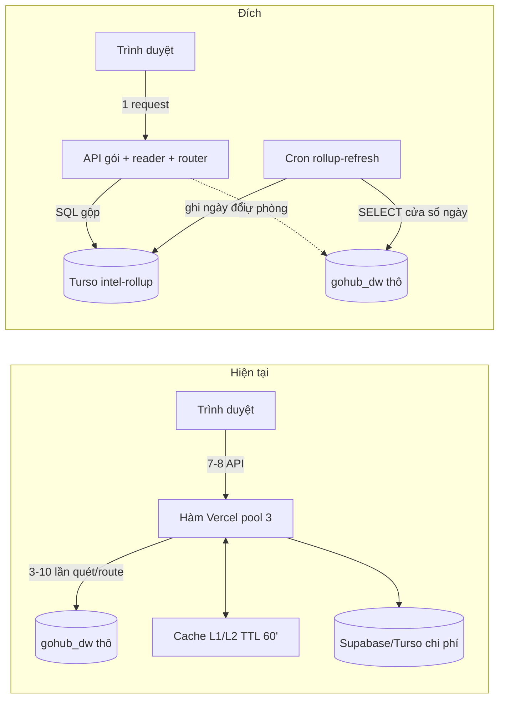
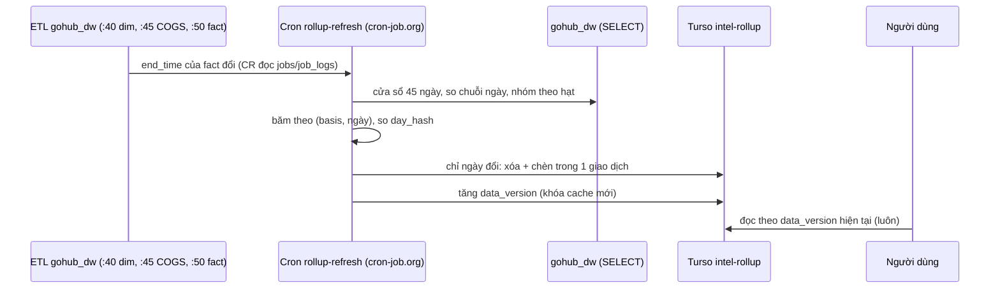
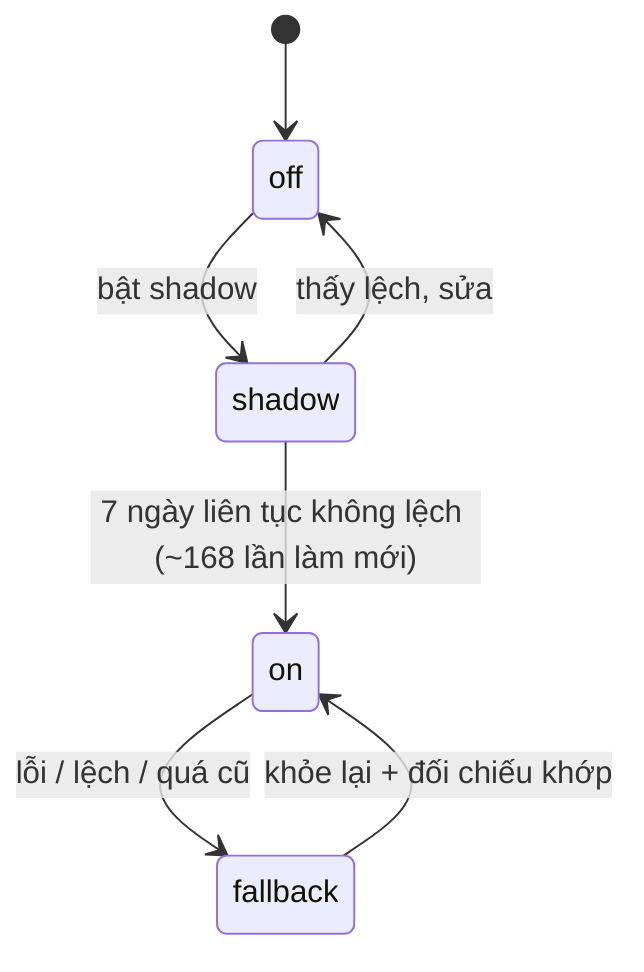

# Plan — Rollup Analytics (bảng tổng hợp sẵn trong Turso)

> Trạng thái: **P0 (nền móng) ĐÃ LÀM trên `staging` (2026-10-28)** — chưa tab nào đọc rollup (P1 là Quarter Report). Xem §14. Bản có hình vẽ đầy đủ: Artifact `claude.ai/artifact/AKopqC2UApuk2iyFD1ia8a`.
> Đọc file này TRƯỚC khi đặt tên hay viết bất cứ thứ gì liên quan rollup. Đổi thiết kế thì sửa file này cùng lúc.

## 1. Điều đã chốt (Hiếu, 2026-10-28)

Ràng buộc:
- **R1** `gohub_dw` chỉ đọc: không sửa, không thêm bảng/chỉ mục/view; chỉ SELECT.
- **R2** Không phát sinh chi phí: chỉ gói free đang có (Turso free, Vercel Hobby, cron-job.org).
- **R3** Dự đoán quy mô suy ra từ dữ liệu thật bằng kịch bản; không dùng con số Hiếu đưa.
- **R4** Số liệu các tab KHÔNG đổi; tab chỉ bật rollup sau khi đối chiếu khớp bảng thô.

Quyết định:
- **Q1** Nơi lưu: Turso gói free, database riêng `intel-rollup`.
- **Q2** Số đơn: lưu `orders` theo từng ngày, chấp nhận lệch nhỏ khi một đơn giao nhiều ngày (đo thật 4.546/499.003 đơn = 0,91%).
- **Q3** Thứ tự tab: Quarter Report → B2B Performance → B2C Performance → Channels → các tab khác.
- **Q4** Độ trễ dữ liệu: theo chu kỳ ETL hằng giờ.

## 2. Số đo thật (28/10/2026, SELECT đọc-only)

| Mục | Số đo |
|---|---|
| `fact_fulfillment_revenue` | 652.741 dòng, 186 MB, 01/2025–10/2026; `fact_sales_revenue` 272.889 dòng; cả `gohub_dw` ≈ 410 MB |
| Chỉ mục | chỉ khóa chính `id`; cột ngày `fulfiled_date`, `created_date` là `varchar` (10 ký tự) |
| Tốc độ | `COUNT(*)` ≈ 0,35s lần đầu; truy vấn kiểu BOD 1,5–3,7s lần đầu = 2,3–5,7 µs/dòng của CẢ bảng (mọi truy vấn quét cả bảng) |
| Ép kiểu ngày | 786ms (`::date`) vs 611ms (so chuỗi) lần đầu → không phải thủ phạm chính |
| Hạt rollup | ngày×kênh×công ty×khách×ship = **205.376**; ngày×kênh×công ty×SKU = **258.353**; ngày×kênh×khách×SKU = 373.598 (bỏ) |
| Đối tượng | 137.947 khách, 7.791 SKU, 76 nguồn, 3 công ty |
| Tăng trưởng | 9 tháng đầu 2026 vs 2025: 244.740 vs 242.329 dòng (+1%); Q4/2025 cao 1,7× nhưng Q4/2026 chưa lặp lại |
| ETL | dim `:40`, COGS `:45`, fact giao hàng `:50` hằng giờ (`jobs.cron_schedule`) |

Dự đoán thời gian truy vấn thô lúc cache nguội = N × 5,5 µs (cận trên đo được), giới hạn app 25s:

| Kịch bản | Hiện tại | +1 năm | +3 năm | +5 năm |
|---|---|---|---|---|
| A phẳng (~370k dòng/năm) | 0,65M · 3,6s | 1,02M · 5,6s | 1,76M · 9,7s | 2,50M · 13,8s |
| B +25%/năm | 0,65M · 3,6s | 1,12M · 6,1s | 2,42M · 13,3s | 4,45M · 24,5s |
| C ×2/năm (căng) | 0,65M · 3,6s | 1,39M · 7,7s | 5,83M · 32,1s | 23,6M · 129,8s |

## 3. Kiến trúc

## 4. Mô hình dữ liệu (Turso `intel-rollup`)

Rollup chỉ chứa **mã** + **số cộng được**; nhãn lấy từ `dm_*` lúc đọc.

`ru_cust_day` — hạt ngày × kênh × công ty × khách × ship
- Khóa: `basis, day, company, source, customer, ship`
- Số: `revenue_vnd, cogs_vnd, gp_vnd, qty, lines, orders, hk3_rev_vnd` (+ số đo theo nhóm vendor khác nếu audit thấy cần)

`ru_sku_day` — hạt ngày × kênh × công ty × SKU
- Khóa: `basis, day, company, source, sku`; số: `revenue_vnd, cogs_vnd, gp_vnd, qty, lines, orders`

Bản sao dim: `dm_source` (76), `dm_customer` (khách có trong rollup), `dm_sku`, `dm_staff`.
Điều khiển: `ru_meta` (`day_hash[basis,day]`, `data_version`, `etl_end_seen[job]`, `last_refresh_at`, `quota_writes_month`, `reconcile_last`), `ru_runlog`.

## 5. Quy trình làm mới

- Mỗi đêm: đối chiếu tổng theo từng THÁNG rollup vs thô (chia tháng để không chạm 25s); tháng lệch dựng lại; lệch quá ngưỡng báo `alertCronFailure`.
- Mỗi tuần: làm mới `dm_*` theo băm, dựng lại số đo theo nhóm vendor; kiểm hạn mức Turso.
- Hạn mức: ghi > 70% → hạ cửa sổ về hôm nay + hôm qua; > 90% → dừng ghi, mọi route rơi về đường thô.

## 6. Router (aggregate awareness)

1. Rollup phủ đủ ngày yêu cầu và `last_refresh_at` ≤ 3 giờ? Không → ĐƯỜNG THÔ (đếm bộ đếm dự phòng).
2. Lọc theo SKU/vendor/loại SP/nước? Không → `ru_cust_day`. Có → cần đồng thời loại khách/tier/nhân viên? Không → `ru_sku_day`; Có → ĐƯỜNG THÔ (hiếm, ghi bộ đếm để quyết sau có dựng bảng khách×SKU không).

Tính lúc đọc (KHÔNG lưu): CM1, GPM %, CM1 %, tier (Strategic/VIP/Gold/Silver qua `makeClassifyTier`), danh sách loại trừ khách, chi phí kênh/khách.

## 7. Trạng thái từng tab

Cờ: `app_settings` khóa `rollup_routes` = `{ "<route>": "off|shadow|on" }`. `shadow` chạy cả hai đường, so sánh, vẫn TRẢ đường thô.
Khớp = doanh thu, giá vốn, GP, số lượng bằng nhau; số đơn lệch ≤ 1%.

## 8. Lộ trình & cổng

| GĐ | Việc | Cổng sang GĐ sau |
|---|---|---|
| **P0** Nền móng | tạo DB `intel-rollup`; schema; dựng 22 tháng cho `ful` và `sal`; `dm_*`; cron làm mới; đối chiếu; trang `rollup-health` (Data Map); giám sát hạn mức | đối chiếu 0 lệch mọi tháng; một lần làm mới ≤ 30s; ghi/đọc trong hạn mức |
| **P1** Quarter Report | audit SQL (`quarterly-report`, `quarterly-b2b-customers`, `quarterly-daily`, `squad-progress`, `quarterly-customer-lifecycle`); thêm số đo (hk3…); reader + router; shadow → on | 7 ngày shadow không lệch; lạnh ≤ 1,5s, nóng ≤ 0,5s (mục tiêu) |
| **P2** B2B Performance | `b2b/performance`, `trend`, `kpis`, `tier-performance`, `strategic-performance`, `ecom-*` | như P1 |
| **P3** B2C Performance | `b2c/performance`, `kpis`, `trend`, `monthly`, `metric`; `loss-skus` dùng `ru_sku_day` | như P1 |
| **P4** Channels | `channels/performance`, `kpis`, `trend`, `b2b-customers` | như P1 |
| **P5** Tab còn lại | BOD (`bod-*`), Staff, Customers, Products, Vendors, Market, All-Time, Dashboard, Fulfillment; Orders giữ đường thô có phân trang | như P1, từng tab |
| **P6** Kiểm tải & dọn | dữ liệu giả 5M dòng trong SQLite cục bộ; xóa cache thừa; cập nhật wiki | đọc ở 5M dòng giả vẫn trong mục tiêu |

Mỗi GĐ bắt đầu bằng AUDIT: đọc đủ điều kiện SQL từng route để chốt số đo và phép lọc (ma trận tab → rollup trong Artifact mới là bản sơ bộ, chưa audit hết).

## 9. Ngân sách free (ƯỚC TÍNH, thay bằng số đo thật ở P0)

Turso free: 5 GB lưu trữ, 500M lượt đọc/tháng, 10M lượt ghi/tháng (turso.tech/pricing.md).
Ghi ≈ 1,0M/tháng (10%): mỗi giờ 1–2 ngày đổi × ~720 dòng + 0,7M dựng lần đầu. Đọc ≈ 30M/tháng (6%): 200 lượt xem lạnh/ngày × 5 truy vấn × ~30k dòng. Dung lượng ≈ 70 MB (1,4%).
Truy vấn rollup PHẢI dùng chỉ mục theo `day` (Turso tính lượt đọc theo dòng quét).

## 10. Quy ước đặt tên (tra trước khi đặt tên mới)

| Thứ | Tên chuẩn |
|---|---|
| DB | `intel-rollup` |
| Bảng rollup | `ru_cust_day`, `ru_sku_day` |
| Bản sao dim | `dm_source`, `dm_customer`, `dm_sku`, `dm_staff` |
| Điều khiển | `ru_meta`, `ru_runlog` |
| Mã | `web/src/lib/rollup/` (`schema`, `builder`, `reader`, `router`, `reconcile`) |
| Route | `/api/cron/rollup-refresh`, `/api/analytics/rollup-health` |
| Khóa cache | `ru:` + `data_version` |
| `basis` | `ful` = ngày giao (Fulfillment), `sal` = ngày tạo đơn (Created; `cogs`/`gp` = 0 như hiện nay) |
| `day` | chuỗi `YYYY-MM-DD` |
| `ship` | 1 nếu SKU = `SHIPPINGFEE0` |
| Nhãn UI | `GP`, `CM1`, `GPM %`, `CM1 %`; khóa dữ liệu `gpm2` giữ nguyên |

## 11. Quy tắc bất biến

1. Rollup chỉ chứa số CỘNG ĐƯỢC; tỷ lệ và mọi thứ cần chi phí kênh tính lúc đọc.
2. Rollup lưu MÃ, nhãn lấy từ `dm_*` lúc đọc.
3. Bộ lọc cấu hình được (loại khách, tier, kênh) áp lúc đọc, không nướng vào rollup.
4. Chỉ cron ghi Turso rollup; reader chỉ đọc; đường thô chỉ là dự phòng/đối chiếu.
5. Tab chỉ bật sau shadow + đối chiếu khớp; luôn còn đường thô để rơi về.
6. Số hiển thị không đổi; lệch là lỗi rollup, không phải "cách tính mới".
7. Đổi định nghĩa số liệu làm ở MỘT chỗ dùng chung (`lib/analytics-engine`), không viết lại trong route.
8. KHÔNG bao giờ ghi vào `gohub_dw`; truy vấn của cron phải dùng `statement_timeout` 25s sẵn có.

## 12. Rủi ro / chưa biết

- ETL có thể sửa số cũ (COGS) → đối chiếu từng tháng hằng đêm.
- Cửa sổ làm mới 45 ngày đủ hay chưa → đo ở P0 (cột nào bị ETL sửa lại sau khi ghi).
- Lịch + thời lượng job ETL đơn tạo (`ETL_fact_sales…`) chưa thấy (cột `cron_schedule` bị cắt khi xem).
- Danh sách đầy đủ số đo theo nhóm vendor (ngoài `hk3_rev_vnd`).
- Cách áp `excludeInactiveCustomers` ở rollup khách để khớp tuyệt đối.
- Độ trễ đọc Turso ~150ms (số đo s203) chưa đo riêng cho rollup.

## 13. Khi dữ liệu bị SỬA (không chỉ thêm mới) — bổ sung 2026-10-28

| Loại thay đổi | Xử lý | Độ trễ tối đa |
|---|---|---|
| Đổi NHÃN trong dim (tên kênh/khách/SKU A→B) | rollup lưu mã nên không dựng lại; `dm_*` làm mới sau ETL dim; cả lịch sử hiện tên mới (giống hiện nay vì join dim hiện tại) | ≤ 1 giờ |
| Sửa GIÁ TRỊ trong fact (COGS, đơn hủy, xóa dòng) | băm theo ngày khác → XÓA cả ngày rồi CHÈN lại (dòng bị xóa cũng mất) | ≤ 1 giờ trong cửa sổ 45 ngày; ngoài cửa sổ ≤ 24 giờ (đối chiếu từng tháng hằng đêm) |
| Đổi MÃ (gộp khách X→Y) | như sửa giá trị (mã nằm trong fact); `dm_customer` đồng bộ cả dòng bị xóa | như trên |
| Thuộc tính NƯỚNG VÀO rollup: nhóm vendor của SKU (`hk3_rev_vnd`), cờ `ship` | điểm yếu duy nhất: băm bảng ánh xạ SKU→nhóm vendor; đổi băm thì dựng lại số đo đó toàn lịch sử ngay lần làm mới sau (không chờ cuối tuần) | ≤ 1 giờ |
| Cấu hình Supabase (loại khách, tier, chi phí, target) | áp lúc đọc; nằm trong khóa cache bằng băm cấu hình (như `exclHash`) | ngay |

Cache — ba lớp, cả ba phải xử lý:
1. **Máy chủ (L1/L2 `cachedQuery`)**: khóa gồm `data_version` + băm cấu hình → bản mới = khóa mới, không phục vụ bản cũ (đường hiện tại còn trả bản cũ tới 6 giờ sau hết TTL). `dm_*` và rollup ghi cùng một lần, tăng `data_version` ở BƯỚC CUỐI, nên không có trạng thái nửa mới nửa cũ.
2. **CDN**: `CACHE_HEADERS = s-maxage=300, stale-while-revalidate=600` → tên cũ có thể thấy thêm 5–15 phút theo URL. Route rollup dùng `Cache-Control: no-store` (đã đủ nhanh, không cần cache biên). **Phải làm ở P0/P1.**
3. **Trình duyệt (`lib/stale-first.ts`, sessionStorage)**: thêm `data_version` vào khóa để khi dữ liệu đổi không hiện bản cũ thoáng qua.

## 14. P0 — kết quả thực hiện (2026-10-28, `staging`)

Mã: `web/src/lib/rollup/` (`pure`, `client`, `schema`, `source`, `builder`), route `/api/cron/rollup-refresh` (modes `init|refresh|backfill|window|dims|reconcile|health`, Bearer CRON_SECRET), `/api/analytics/rollup-health` (Creator), test `rollup-pure.test.ts` (13).
- **DB:** chưa tạo `intel-rollup` riêng (cần tài khoản Turso). Tạm dùng DB config qua `TURSO_URL` — bảng có tiền tố `ru_`/`dm_`. Khi tạo DB riêng: đặt `ROLLUP_TURSO_URL/ROLLUP_TURSO_AUTH_TOKEN` rồi chạy `mode=init` + `backfill` + `dims` lại; không cần đổi mã.
- **Ghi giao dịch:** request `batch` của Hrana (COMMIT chỉ khi các bước trước đều ok, ngược lại ROLLBACK); mỗi ngày một giao dịch (xoá ngày rồi chèn lại).
- **Số đo thật:** dựng 22 tháng cho `ful` (666 ngày, 205.381 dòng khách, 258.442 dòng SKU) và `sal` (319 ngày, 10.672 / 145.387); `dm_customer` 355.420, `dm_sku` 29.305, `dm_source` 138, `dm_staff` 155. Mỗi tháng dựng ~10s (2 truy vấn gom, tuần tự), làm mới 45 ngày ~3–6s và chỉ ghi ngày đổi (hash cyrb53); dựng khách 355k dòng ~75s sau khi gộp ghi theo trang. Ghi tháng 10/2026 ≈ 1,0M lượt (10% hạn mức, đa số là dựng lần đầu).
- **Đối chiếu:** 46/46 (23 tháng × 2 cơ sở) khớp bảng thô về doanh thu, giá vốn, GP, số lượng, số dòng.
- **Phát hiện dữ liệu:** 88 dòng ngày 31/12/2025 (đơn `BPTxxx*`) có `cogs`/`gp` = `NaN` trong `fact_fulfillment_revenue`; `SUM` thô thành NaN cho mọi tổng gồm ngày đó (các tab hiện tại cũng bị). Rollup coi NaN = 0 ở tiền/giá vốn/GP (`'NaN'::numeric`), nên tab chuyển sang rollup sẽ hết NaN: khác với đường thô ở đúng điểm này.
- **Cột ngày:** `fact_sales_revenue.created_date` là **timestamp** (khác `fulfiled_date` là varchar); `fact_sales_revenue` có cả `cogs_amount_vnd`/`gross_profit_vnd` nhưng các tab hiện tại coi Created không có margin → rollup `sal` giữ 0 để khớp. Có cột `etl_updated_at` (dấu thời gian ETL) có thể dùng phát hiện ngày đổi sau này.
- **Kích hoạt:** `etl-cache-sync` (cron-job.org đã gọi 10–15') sau khi phát hiện ETL xong sẽ tự gọi `refreshRecent(45)` ở nền (không cần job ngoài mới). Vercel Cron thêm: `rollup-refresh?mode=reconcile&months=3` (03:00 ICT hằng đêm, báo Lark khi lệch) và `?mode=dims` (Chủ nhật).
- **Còn lại của P0:** tạo DB `intel-rollup` riêng (Hiếu), trang health trong Data Map, theo dõi hạn mức Turso 70%/90% (chốt chặn chưa code), thời gian ETL đơn tạo.

## 15. P1 — Quarter Report, route `quarterly-report` (2026-10-28, `staging`)

Mã: `lib/rollup/filters.ts` (bộ lọc SQLite tương đương `shipFilter`/`internalOpsFilter`/INACTIVE/`makeExcludeSql`), `quarter.ts` (3 truy vấn rollup đúng hình dạng đường thô + `diffRows`), `mode.ts` (cờ `rollup_routes` off|shadow|on trong app_settings, `rollupState` = version + độ tươi ≤ 3h); route đã nối: khoá cache thêm `:ru<data_version>` khi `on`; `shadow` ghi kết quả so sánh vào `ru_runlog`; lỗi/cũ thì rơi về đường thô. Đặt cờ: `GET /api/cron/rollup-refresh?mode=flag&route=quarterly-report&value=…` (Bearer CRON_SECRET).
- **Shadow:** 10 tổ hợp (Q2/Q3/Q4-2026, Q4-2025, Q1-2026; ALL/VN/US; ship và nội bộ bật/tắt) khớp 10/10.
- **Response đầy đủ:** so JSON cuối của `on` với đường thô: 8/10 giống hệt; 2 khác đều do NaN (xem §14): Q4-2025 và `prevQuarterTotals` của Q1-2026 — đường thô trả `null` cho GP/CM1 (NaN), rollup trả số thật (Q4-2025: GP 2.821.687.796).
- **Tốc độ:** đường thô lần nguội 3,7–14,4s (đo từ shadow); `on` ≈ 0,9–3,9s toàn request, phần còn lại là chi phí Supabase/Turso và `fetchB2BLifecycleRows` (vẫn quét thô, cache 6h) — việc kế tiếp.
- **Bẫy:** các request thử PHẢI thêm tham số khác nhau (`&_b=…`): CDN cache theo URL (`s-maxage=300`) nên cùng URL `nocache=1` vẫn trả bản cũ — đúng lỗ hổng cache biên đã nêu ở §13.
- **Trạng thái cờ:** `shadow` (trả đường thô). Cờ nằm trong app_settings dùng CHUNG staging/production: khi merge `main`, production đọc cùng cờ.
- **Còn lại của P1:** vòng đời khách (lifecycle) từ `ru_cust_day`; các route khác của tab (`quarterly-b2b-customers`, `squad-progress`, `quarterly-daily`, `quarterly-customer-lifecycle`); bỏ cache biên cho route rollup; 7 ngày shadow trước khi bật `on`.
